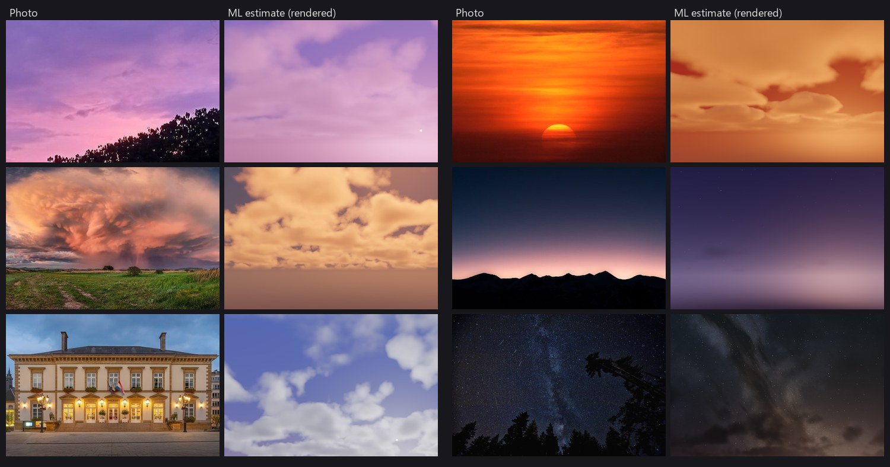
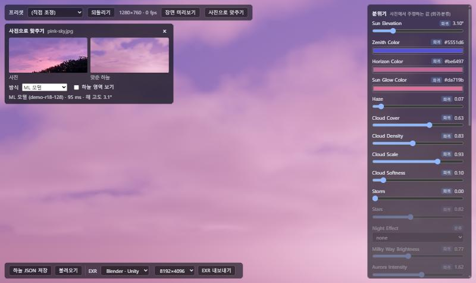

# Sky Match

Turn a photo of the sky into the **parameters (θ) of a procedural sky shader**. You can then look at the sky on the web, and use it in Blender, Godot and Unity.

**Live demo:** https://hyunseungje.github.io/SkyMatch/



```
photo ──► estimate (ML model or optimiser) ──► θ (sky JSON) ──► web preview
                                                         ├─► Blender · Godot · Unity (real-time shader)
                                                         └─► EXR panorama
```

## Features



- **Edit the sky.** Sliders set sun elevation, three sky colours (zenith, horizon, sun glow), haze, clouds, storm, stars, the Milky Way and aurora. Presets are included.
- **Match a photo.** Pick, drop or paste a photo, and the app estimates the sky parameters. **The photo never leaves the browser.** There are two methods:
  - **ML model (default):** a neural network trained on synthetic images estimates the sky in one pass, about 0.05 s per photo.
  - **Optimiser (CMA-ES):** renders hundreds of candidate skies and fits them to the photo. It takes a few seconds.
- **Scene preview.** Walk around a simple scene under the sky.
- **Export.**
  - **Sky JSON:** one small file that Blender, Godot and Unity load.
  - **EXR:** a linear HDR equirectangular panorama.

The web UI is in Korean.

## Repository layout

| Folder | Contents |
|---|---|
| [`sky/`](sky) | Sky shader source (`skyV1.glsl`), parameter schema (`sky_schema_v1.json`, frozen at 1.0), presets, noise texture |
| [`web/`](web) | Web app (Vite, TypeScript, three.js): photo matching, in-browser ML inference (onnxruntime-web), export |
| [`ports/`](ports) | Shaders and loaders for Blender (OSL), Godot and Unity; how to use them: [`ports/README.md`](ports/README.md) |
| [`ml/`](ml) | Synthetic dataset generation and model training (Python, PyTorch) |
| [`tools/`](tools) | Engine shader generation, building a Blender `.blend`, noise texture generation |

## The ML model

- **Training data:** 200,000 synthetic images rendered with the shader itself (180,000 train, 10,000 validation, 10,000 test). Real photos are never used for training, only for evaluation.
  - The dataset is defined by one config file, [`ml/datasets/v2.toml`](ml/datasets/v2.toml). The same config always gives the same data. v2 is v1 plus one label rule: a milky way or aurora that is not visible in the image is labelled "none".
  - How it is made, step by step (in Korean): [`ml/DATASET.md`](ml/DATASET.md)
- **Model:** a ResNet starting from ImageNet weights. It takes a 128×96 image, regresses the sky parameters and classifies the night effect.
  - Loss, augmentation and run records (in Korean): [`ml/TRAINING.md`](ml/TRAINING.md)
  - Model selection: the epoch with the lowest validation loss, early stopping after 5 epochs without a new lowest; between candidates, again the lowest validation loss.
- **Current web model:** `r50-aug3`, ResNet-50 with flip, blur and noise augmentation, trained on dataset v2 (epoch 28 of 30). The model file is about 95 MB.
  - Synthetic test set: sun elevation error 3.8°, zenith colour about 12/255 per channel, night effect accuracy 97 %.
  - Against the CMA-ES optimiser on 200 synthetic test images: sun elevation error 3.8° vs 14.7°, SSIM of the re-rendered sky 0.95 vs 0.89, about 100× faster. Details: [`ml/experiments/bench-2026-11-24/`](ml/experiments/bench-2026-11-24/README.md)
  - Known weakness: it recognises only about a third of real night photos as night (21 of 68 in the real-photo test set).

## Running it yourself

Web app (Node 24):

```sh
cd web
npm ci
npm run dev        # http://localhost:5173
npm run build      # dist/
```

Dataset generation and training (Python 3.12+, [uv](https://docs.astral.sh/uv/)):

```sh
cd ml
uv sync --group train
uv run python -m skymatch_ml.generate --config datasets/v1.toml --out <data dir> --preview 64
uv run python -m skymatch_ml.train --data <data dir> --out <run dir> --epochs 10
```

Put the resulting `model.onnx` and `model.json` in `web/public/models/sky-v1/` and the web app uses them.

Every push to `main` is built by GitHub Actions and deployed to GitHub Pages.

## License

MIT ([`LICENSE`](LICENSE)). Parts of `sky/skyV1.glsl` and of the engine shaders generated from it are adapted from "Fast semi-physical atmosphere" by Felix Westin (MIT); each of those files keeps its notice. The photos in the README images are CC0, from Wikimedia Commons: [`docs/images/CREDITS.md`](docs/images/CREDITS.md).
